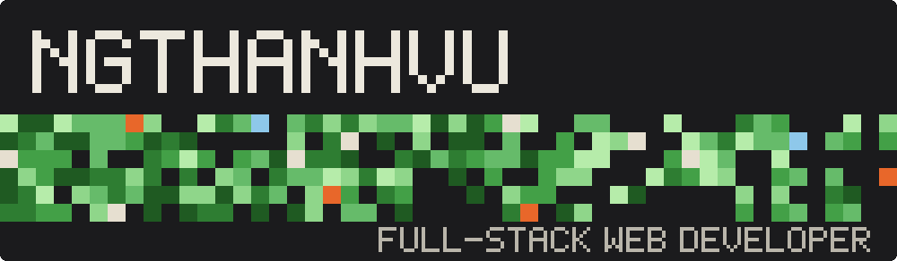

<div align="center">
  
</div>


```text
Hey, I'm Vu - a passionate web developer creating robust and scalable
web applications. I work across the front-end and back-end, with a strong
focus on user experience and performance optimization.
```


```text
> Build full-stack apps with Laravel, NestJS, Go, Vue/Nuxt and React/Next.js
> Ship reliably with Docker and CI/CD pipelines
> Use AI tools (Claude, Cursor, Gemini, OpenAI) to build faster and learn better
> Care about clean architecture, smooth UX and performance
```


<table align="center">
  <tr>
    <th align="center">GitHub</th>
    <th align="center">Facebook</th>
  </tr>
  <tr>
    <td align="center" width="140">
      <a href="https://github.com/ngthanhvu"></a>
    </td>
    <td align="center" width="140">
      <a href="https://www.facebook.com/thanhvu.user"></a>
    </td>
  </tr>
</table>


<div align="center">
  
</div>


<table align="center">
  <tr>
    <td align="center"><br/><sub>PHP</sub></td>
    <td align="center"><br/><sub>Laravel</sub></td>
    <td align="center"><br/><sub>Golang</sub></td>
    <td align="center"><br/><sub>Python</sub></td>
    <td align="center"><br/><sub>NestJS</sub></td>
    <td align="center"><br/><sub>MySQL</sub></td>
    <td align="center"><br/><sub>TypeScript</sub></td>
    <td align="center"><br/><sub>Vue</sub></td>
    <td align="center"><br/><sub>React</sub></td>
  </tr>
  <tr>
    <td align="center"><br/><sub>Nuxt</sub></td>
    <td align="center"><br/><sub>Next.js</sub></td>
    <td align="center"><br/><sub>Docker</sub></td>
    <td align="center"><br/><sub>CI/CD</sub></td>
    <td align="center"><br/><sub>OpenAI</sub></td>
    <td align="center"><br/><sub>Gemini</sub></td>
    <td align="center"><br/><sub>Claude</sub></td>
    <td align="center"><br/><sub>Cursor</sub></td>
    <td></td>
  </tr>
</table>

<div align="center">
  <br/>
  
  <a href="https://buymeacoffee.com/#"></a>
</div>
